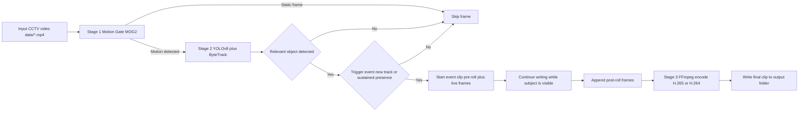
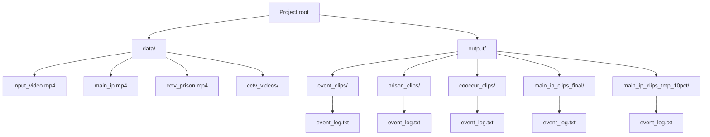

# CCTV Event Clip Extraction Pipeline

A production-style pipeline for extracting important activity segments from long CCTV recordings and exporting compact event clips.

The system uses a three-stage workflow:
1. Motion filtering (MOG2)
2. Object detection and tracking (YOLOv8 + ByteTrack)
3. Event clip encoding (H.265/H.264)

Compression is integrated directly into the main pipeline through selectable run modes.

## 0) Quickstart (Beginner-Friendly)

This section is designed so you can run the project end-to-end without reading the rest first.

### Option A - Run the Web App (recommended)

1) Create + activate a Python virtual environment (Windows PowerShell)

```powershell

python -m venv .venv
.\.venv\Scripts\Activate.ps1
python -m pip install --upgrade pip

```

If PowerShell blocks activation, either:
- run `Set-ExecutionPolicy -Scope CurrentUser RemoteSigned` once, then re-run activation, OR
- use Command Prompt activation: `.\.venv\Scripts\activate.bat`

2) Install dependencies

- CPU-only (simplest):

```bash

pip install -r requirements.txt

```

- NVIDIA GPU (CUDA) (recommended if available):
  - Install PyTorch for your CUDA version from the official PyTorch selector, then install the rest.
  - A common setup looks like:

```bash

pip uninstall -y torch torchvision torchaudio
pip install torch torchvision torchaudio --index-url https://download.pytorch.org/whl/cu118
pip install opencv-python ultralytics numpy imageio-ffmpeg flask werkzeug

```

3) Set the compute device

The web app uses `config.py` for its device selection. If you do NOT have a CUDA-capable GPU, set:
- `YOLO_DEVICE = "cpu"` in `config.py`

4) Start the server

```bash

python app.py

```

Then open: `http://localhost:5000`

5) Upload a video and wait

Outputs are written under:
- `uploads/` (original upload)
- `output/<task_id>/` (event clips + `event_log.txt`)

### Option B - Run the CLI Pipeline

1) Put a video in `data/` (create the folder if it doesn't exist)

Example: `data/my_video.mp4`

2) Run extraction (CPU example)

```bash

python main.py --input my_video.mp4 --out-folder event_clips --device cpu --compression-mode normal

```

Your clips and `event_log.txt` will be in `output/event_clips/`.

3) Quick test mode (recommended before long runs)

```bash

python main.py --input my_video.mp4 --out-folder event_clips_test --device cpu --compression-mode normal --max-percent 10

```

Notes:
- If you have a CUDA GPU, replace `--device cpu` with `--device cuda`.
- `--input` can also be an absolute path outside `data/`.

## 1) Project Objective

Transform long surveillance footage into short, event-focused clips while:
- preserving meaningful activity,
- removing long inactive intervals, and
- reducing storage requirements.

## 2) End-to-End Workflow

### 2.1 Pipeline Flowchart



### 2.2 Stage Details

### Stage 1: Motion Gate (Fast Pre-Filter)
- Tool: OpenCV MOG2 background subtraction
- Purpose: reject static frames before running YOLO
- Benefit: reduces expensive detector calls and improves throughput

### Stage 2: Subject Verification (YOLOv8 + ByteTrack)
- Tool: Ultralytics YOLOv8 (`yolov8n.pt`) with built-in tracking
- Purpose: retain only relevant classes (person, vehicle, selected animals/objects)
- Additional filtering:
  - minimum bounding box area to suppress tiny false positives
  - minimum track age before confirming new tracks

### Trigger Logic (Heuristic)
- Event starts when:
  - a new confirmed track appears, or
  - sustained subject presence is detected (high-recall fallback)
- Event timing controls:
  - pre-roll and post-roll context
  - maximum clip duration cap
  - minimum idle gap between events

### Stage 3: Clip Writing + Encoding
- Raw clip is written with OpenCV (`mp4v`) and re-encoded with FFmpeg
- Preferred codec: H.265 (`libx265`) with H.264 fallback
- Optional playback speed-up via higher output FPS
- Compression profiles in the same pipeline run:
  - `normal`: faster processing, moderate compression
  - `aggressive`: slower processing, smaller output size

### 2.3 Model Architecture & System Classification (Single-Model vs Multi-Model)

#### Is this project using a Single-Model or Multi-Model system?
* **Deep Learning (Neural Network) Level: SINGLE-MODEL SYSTEM.**
  The pipeline utilizes exactly **one** deep neural network: **Ultralytics YOLOv8-nano (`yolov8n.pt`)**. It deliberately does not run multiple neural networks in parallel (such as separate secondary CNN classifiers, heavy Re-ID embedding networks, or multimodal vision-language models) in order to maintain real-time throughput (>60–80 FPS on GPU, >20 FPS on CPU) and a lightweight memory footprint (~150–250 MB VRAM).
* **Overall System / Pipeline Level: MULTI-STAGE CASCADE HYBRID SYSTEM.**
  The end-to-end framework couples 4 distinct complementary components:
  1. **Stage 1 (Statistical Pre-Filter):** OpenCV MOG2 Gaussian Mixture Background Subtractor (drops 70%–85% of static frames without invoking deep learning).
  2. **Stage 2A (Deep Learning Detection Core):** YOLOv8-nano anchor-free object detector.
  3. **Stage 2B (Temporal Association):** ByteTrack Kalman Filter + bipartite matching (avoids heavy neural Re-ID embeddings).
  4. **Stage 3 (Video Compression Engine):** FFmpeg H.265/HEVC (CRF rate control + `-movflags +faststart`).

#### YOLOv8n Deep Learning Architecture Details
* **Backbone:** Modified CSPDarknet53 utilizing **C2f modules** (Cross-Stage Partial Bottlenecks with 2 Convolutions) for enhanced gradient flow, with **SiLU** activations and **SPPF** (Spatial Pyramid Pooling - Fast) max-pooling.
* **Neck:** Path Aggregation Feature Pyramid Network (**PAN-FPN**) fusing multi-scale feature maps at P3 (stride 8, fine detail), P4 (stride 16, medium targets), and P5 (stride 32, semantic context).
* **Head:** **Anchor-Free Decoupled Head** separating classification and bounding box regression into parallel convolutional pathways.
* **Loss Functions:** Task-Aligned Assigner (TAL) combining Binary Cross-Entropy (**BCE**) for class classification with Complete IoU (**CIoU**) and Distribution Focal Loss (**DFL**) for box regression.
* **Model Footprint:** ~3.16M parameters, ~8.7 GFLOPs at 640×640 input resolution.

> 📖 **Comprehensive Technical Deep-Dive:** For full mathematical formulations, layer diagrams, and tracking equations, see [detailed.md](file:///c:/Users/mribl/Documents/GitHub/ByteForceDev/ML-Based-CCTV-Video-Compression/detailed.md).

### 2.4 Multi-Dimensional Performance & Evaluation Metrics (Beyond Accuracy)

In 24/7 CCTV surveillance footage, 95%–99% of frames are inactive background. A naive model that classifies every frame as "no event" would achieve 99% raw accuracy while missing 100% of security events. Therefore, our pipeline evaluates dedicated multi-dimensional metrics across each stage:

| Stage / Component | Key Evaluation Metrics (Beyond Accuracy) | Purpose & Ideal Target |
| :--- | :--- | :--- |
| **Stage 1: Motion Gate (MOG2)** | • **Motion Recall (TPR):** $\ge 99.0\%$<br>• **Static Rejection Specificity (TNR):** $70\% - 90\%$<br>• **Miss Rate (FNR):** $< 1.0\%$<br>• **Throughput Speed:** $> 400\text{ FPS}$ on CPU | Guarantees zero missed security activity while maximizing frame elimination before neural inference. |
| **Stage 2A: Detector (YOLOv8n)** | • **mAP@0.50 & mAP@0.50:0.95:** $> 0.65$ / $> 0.37$<br>• **Precision ($P$) & Recall ($R$):** $> 0.85$ / $> 0.80$<br>• **$F_2$-Score (Recall-Biased):** Prioritizes target detection<br>• **Inference Latency:** Mean $< 15\text{ ms}$, P95 $< 25\text{ ms}$ (CUDA) | Measures detection fidelity and operational real-time capability across surveillance classes. |
| **Stage 2B: Tracker (ByteTrack)** | • **MOTA (Multiple Object Tracking Accuracy)**<br>• **MOTP (Overlap Precision)**<br>• **IDF1 (Identity F1-Score):** $> 70\%$<br>• **HOTA (Higher Order Tracking Accuracy)**<br>• **ID Switches (IDSW) & Fragmentation (Frag)** | Evaluates trajectory continuity and track persistence across occlusions without Re-ID model overhead. |
| **Stage 3: Video Coding & Quality** | • **Storage Reduction Ratio (SRR):** $75\% - 95\%$ saved<br>• **Temporal Reduction Ratio (TRR):** $80\% - 95\%$ idle cut<br>• **Event Capture Recall (ECR):** $\ge 98.0\%$<br>• **Reconstructed PSNR & SSIM:** PSNR $> 35\text{ dB}$, SSIM $> 0.98$<br>• **Output Bitrate (kbps)** | Validates storage compression gains while ensuring forensic evidence quality remains uncompromised. |

### 2.5 Simulating and Benchmarking the Metrics
You can simulate and measure all the above metrics on your machine using the built-in benchmarking suite:

```bash
# Run simulation benchmark on sample CCTV video (CUDA or CPU auto-detected)
python simulate_metrics.py --input data/cctv_prison.mp4 --frames 120

# Run simulation explicitly on CPU
python simulate_metrics.py --input data/cctv_prison.mp4 --frames 100 --device cpu
```

The tool benchmarks each stage, prints an interactive summary table, and exports full JSON analytics to `output/simulation_results/simulation_report.json`.

## 3) Repository Files

- `main.py`: primary extraction pipeline (MOG2 + YOLOv8 + FFmpeg)
- `config.py`: runtime thresholds and paths (`DATA_FOLDER`, `OUTPUT_ROOT`)
- `detailed.md`: in-depth technical documentation covering architecture, single vs multi-model breakdown, mathematical formulations, and metric formulas
- `simulate_metrics.py`: benchmarking and simulation engine for evaluating latency, throughput, tracking stability, compression ratios, and PSNR/SSIM visual fidelity
- `compress_event_clips.py`: optional standalone post-compression utility
- `cooccur_detect.py`: standalone co-occurrence detector (car + bus)
- `test_cooccurrence.py`: experimental/legacy co-occurrence test script
- `requirements.txt`: Python dependencies

## 4) Input and Output Structure

All source videos and generated clips are organized under two root folders:

- `data/` (not committed): source videos and datasets
  - `data/input_video.mp4`
  - `data/main_ip.mp4`
  - `data/cctv_prison.mp4`
  - `data/cctv_videos/`

- `output/` (not committed): generated event clips
  - `output/event_clips/`
  - `output/prison_clips/`
  - `output/cooccur_clips/` (legacy/experimental)
  - `output/main_ip_clips_final/` (final target output)
  - `output/main_ip_clips_tmp_10pct/` (optional partial-run output)

Each output subfolder contains:
- Event clip `.mp4` files
- One `event_log.txt` timeline and size summary

### 4.1 Folder Layout Diagram



All `.mp4` files and all contents under `data/` and `output/` are gitignored by default to keep the repository lightweight.

## 5) Environment Setup

### 5.1 Prerequisites

- Python 3.10+ recommended
- Disk space: the first run may download:
  - YOLO weights (`yolov8n.pt`) via Ultralytics
  - an FFmpeg binary via `imageio-ffmpeg`

### 5.2 Create a virtual environment (recommended)

Windows (PowerShell):

```powershell

python -m venv .venv
.\.venv\Scripts\Activate.ps1
python -m pip install --upgrade pip

```

macOS / Linux:

```bash

python3 -m venv .venv
source .venv/bin/activate
python -m pip install --upgrade pip

```

### 5.3 Install dependencies (CPU vs CUDA)

This project depends on:
- `opencv-python` (video decode + frame processing)
- `ultralytics` (YOLOv8 detection + ByteTrack tracking)
- `torch` / `torchvision` (deep learning backend for YOLO)
- `imageio-ffmpeg` (FFmpeg binary used for clip encoding)
- `flask` + `werkzeug` (web app)

CPU-only (works everywhere):

```bash

pip install -r requirements.txt

```

CUDA GPU (faster):
- Install PyTorch for your CUDA version using the official PyTorch instructions.
- Then install the remaining packages (to avoid accidentally installing a CPU-only torch build):

```bash

pip install opencv-python ultralytics numpy imageio-ffmpeg flask werkzeug

```

### 5.4 FFmpeg note

You usually do NOT need to install FFmpeg manually.
The scripts call `imageio_ffmpeg.get_ffmpeg_exe()`, which downloads/uses a packaged FFmpeg binary.

If you still see encoding errors, installing FFmpeg system-wide and adding it to PATH can help.

### 5.5 Verify your installation

```bash

python -c "import cv2, torch; import ultralytics; print('cv2:', cv2.__version__); print('torch:', torch.__version__); print('cuda:', torch.cuda.is_available())"

```

## 6) Usage

### A) Web Interface (Flask App) 
The project now features a premium, responsive web interface built with Flask.

```bash

# Start the web server
python app.py

```

After starting the server, go to `http://localhost:5000` in your browser. 
Device note:
- If you do not have a CUDA GPU, set `YOLO_DEVICE = "cpu"` in `config.py` before starting the server.

Features of the UI:
- **Drag & Drop Upload:** Upload CCTV footage (`.mp4`, `.avi`, `.mkv`).
- **Real-time Processing Stats:** Watch deep-learning analysis progress live, updated continuously without blocking the UI.
- **Advanced Statistical Breakdown:** Instantly view calculated metrics such as Original Video Length, Extracted Video Length, Total Input Size, Extracted Size, and Size Reduction Percentage.
- **Dynamic Clips Gallery:** View all detected event chunks seamlessly in an interactive viewer directly on the page.
- **Permanent Processing History:** The dashboard natively tracks processing metadata. All past extractions are dynamically cataloged in a "Previously Extracted Videos" list below the uploader. Click any prior item to instantly reload its stats, playback gallery, and downloads instantly without reprocessing.
- **Downloads:** Easily download individual clips, an aggregate ZIP archive of all events, and comprehensive event logs containing size reduction statistics.

### B) CLI: Extract event clips (normal compression)
If you don't have an NVIDIA GPU, replace `--device cuda` with `--device cpu`.

```bash

python main.py \
  --input main_ip.mp4 \
  --out-folder main_ip_clips_final \
  --device cuda \
  --compression-mode normal

```

### C) CLI: Extract event clips (aggressive compression)

```bash

python main.py \
  --input main_ip.mp4 \
  --out-folder main_ip_clips_final \
  --device cuda \
  --compression-mode aggressive

```

`--input` and `--out-folder` are logical names:
- relative inputs resolve to `data/<name>`
- relative outputs resolve to `output/<folder>`

### D) CLI: Run on alternative inputs

```bash

python main.py \
  --input input_video.mp4 \
  --out-folder event_clips \
  --device cuda \
  --compression-mode normal

python main.py \
  --input cctv_prison.mp4 \
  --out-folder prison_clips \
  --device cuda \
  --compression-mode aggressive

```

### D.1) CLI: Quick test mode (process only part of the video)
Use this to validate thresholds and performance before running a full-length CCTV file.

```bash

python main.py --input main_ip.mp4 --out-folder main_ip_clips_tmp_10pct --device cuda --compression-mode normal --max-percent 10

```

### E) Optional standalone post-compression utility

```bash

python compress_event_clips.py \
  --input-folder output/event_clips \
  --output-folder output/event_clips_compact \
  --encoder x265 \
  --cq 30

```

## 7) Key Techniques

- MOG2 background subtraction for fast motion segmentation
- YOLOv8n for real-time object detection
- ByteTrack-based multi-object track persistence
- Heuristic event gating for high recall and low idle footage
- FFmpeg-based H.265/H.264 compression
- Runtime-selectable compression profiles (`normal` / `aggressive`)
- **Flask Web Server with polling for real-time UI logging**
- **Premium Glassmorphism styling and vibrant gradients for intuitive UX**

## 8) Collaborators and Credits

This project was built collaboratively by:

- Raghav Mrituanjaya KS - GitHub: [@raghavmri](https://github.com/raghavmri)
- Muppavaram Lohith - GitHub: [@LOHITH5506H](https://github.com/LOHITH5506H)
- Rachakonda Guru Karthikeya - GitHub: [@Karthik1404-h](https://github.com/Karthik1404-h)

All collaborators contributed to the design, implementation, experimentation, and refinement of the CCTV event extraction pipeline. Full credit is shared equally among all three contributors.

## 9) Notes

- Event triggering is heuristic-driven and optimized for practical surveillance footage.
- Compression mode is selected at runtime with `--compression-mode`.
- Use `normal` for faster processing and `aggressive` for maximum storage reduction.

## 10) Debugging

### Common install fixes (PyTorch)

If you see errors like "Torch not compiled with CUDA enabled", you likely installed a CPU-only build of PyTorch.

CUDA example (one common option):

```bash

pip uninstall torch torchvision torchaudio -y
pip install torch torchvision torchaudio --index-url https://download.pytorch.org/whl/cu118

```

CPU-only example:

```bash

pip uninstall torch torchvision torchaudio -y
pip install torch torchvision torchaudio --index-url https://download.pytorch.org/whl/cpu

```

Notes:
- The correct CUDA wheel depends on your GPU + driver + CUDA version; if `cu118` doesn't match your system, use the official PyTorch selector.
- After reinstalling torch, re-run `pip install -r requirements.txt` (CPU) or install the remaining packages (CUDA) as described in section 5.

## 11) Visual Proof: End-to-End Demo Results

The following screenshots show the complete workflow, from source video setup to extracted event clips and final analytics.

### A) The Input Data


### B) CLI Pipeline Startup and Runtime Configuration


### C) Live Web Progress During YOLO Processing


### D) Extracted Highlights Dashboard (Stats + Clips)


### E) Generated Event Log with Timeline and Size Reduction


### F) Sample CCTV Frame from the Input Footage


